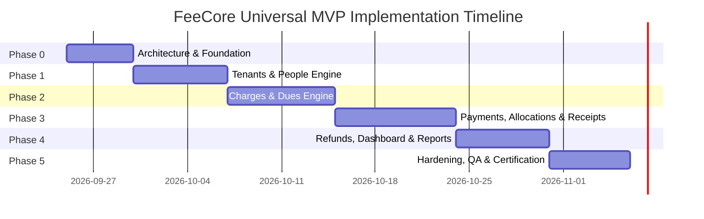

# FeeCore Universal — Development Roadmap & Definition of Done (DoD)

**Document Version:** 2.0.0  
**Status:** Approved Roadmap Baseline (Post Architecture Review)  
**Source Baseline:** `docs/FeeCore_Universal_Business_Requirements_SRS_v2.docx` & Architecture Review Directives  
**Author:** Technical Project Manager & Lead Architect  

---

## 1. Roadmap Overview & Phasing Strategy

The engineering execution of FeeCore Universal is structured into **six sequential, gate-controlled phases**. Each phase produces verified, independently testable increments with strict **Definition of Done (DoD)** criteria that must pass automated and QA gates before progressing to subsequent phases.

---

## 2. Definitive Architecture & Technology Baseline

All development across all phases adheres strictly to the approved stack:
* **Frontend:** React 18+ with TypeScript, Vite, and Vanilla CSS Design System.
* **Backend:** NestJS with TypeScript using Fastify HTTP adapter (`@nestjs/platform-fastify`).
* **Database:** PostgreSQL 16+ with Row-Level Security (RLS) and JSONB.
* **ORM:** Prisma ORM.
* **Validation:** Zod schemas.
* **Money Convention:** `BIGINT` minor units in PostgreSQL, `bigint` in TypeScript, and **Strings** in JSON APIs (`amountMinor: "150050"`).

---

## 3. Detailed Phase Breakdown & Deliverables

### Phase 0: Architecture, Environment & Foundation
* **Focus:** Repository scaffolding, database migrations pipeline, containerized development environment, PostgreSQL Row-Level Security baseline, and automated test harness.
* **Key Deliverables:**
  1. Monorepo structure (`apps/api`, `apps/web`, `packages/shared-types`).
  2. NestJS + Fastify server bootstrap with global Zod validation pipe and Fastify CORS/Helmet configuration.
  3. PostgreSQL schema migrations baseline via Prisma: tenants, users, and RLS policies.
  4. Database connection session hook executing `SET LOCAL app.current_tenant_id` for multi-tenant isolation.
  5. Authentication and JWT token issuance pipeline (Argon2id password hashing).
  6. Integration test harness using Dockerized PostgreSQL test containers.
* **Definition of Done (DoD):**
  - [ ] Database migrations execute cleanly from a cold PostgreSQL instance.
  - [ ] Automated test proves RLS isolation: cross-tenant queries return zero records at database engine level.
  - [ ] Docker compose boots API, Database, and Web SPA in $< 60$ seconds.
  - [ ] 100% CI pass rate on boilerplate lint and type tests.

---

### Phase 1: Identity, Multi-Tenancy & People Management
* **Focus:** Tenant configuration, dynamic terminology dictionary, people registry, and dynamic JSONB custom fields.
* **Key Deliverables:**
  1. `Tenant` and `TenantSettings` models and management APIs.
  2. Dynamic Terminology Dictionary API (`PUT /api/v1/tenant/terminology`) and React `TerminologyContext`.
  3. `Person` domain entity with CRUD, fast indexed search (name, phone, email).
  4. `CustomFieldDefinition` schema builder (Text, Number, Date, Select, Boolean).
  5. Dynamic JSONB custom field validation middleware on Person creation/update via Zod.
  6. Soft-deactivation workflow (`POST /api/v1/people/{id}/deactivate`) preserving full history.
  7. Responsive UI for Tenant Settings, People Directory, and Custom Field Builder.
* **Definition of Done (DoD):**
  - [ ] Verified BR-01: Terminology changes reflect instantly across UI and API without schema migration.
  - [ ] Verified BR-02: People search retrieves records in $< 100\text{ ms}$ over 10,000 seeded rows.
  - [ ] Verified BR-12: Custom fields validate data types, enforce mandatory flags, and store JSONB accurately.
  - [ ] Person soft-deactivation blocks future plan creations while keeping historical records intact.
  - [ ] Unit test coverage $\ge 90\%$ for `PeopleService` and `CustomFieldService`.

---

### Phase 2: Charges, Recurring Plans & Dues Engine
* **Focus:** One-time charges, recurring schedule engine, automated dues generation, discount calculation, and late fee assessment.
* **Key Deliverables:**
  1. `Charge` entity and API: one-time charge creation linked to target Person.
  2. `Discount` engine: percentage and fixed discount arithmetic with boundary checks.
  3. `LateFeeRule` engine: fixed and daily delinquency penalty calculations.
  4. `RecurringPlan` entity: schedule definitions (Daily, Weekly, Monthly, Quarterly, Yearly) with `anchor_day` preservation.
  5. Background Dues Generator worker: deterministic cycle period key hashing and unique constraint duplicate prevention.
  6. Real-time Due tracking API (`/api/v1/dues`) with status lifecycle (`PENDING`, `OVERDUE`).
  7. UI for Charge creation, Recurring Plan management, and Due List.
* **Definition of Done (DoD):**
  - [ ] Verified BR-03: One-time charge creates corresponding Due with correct balance and status.
  - [ ] Verified BR-04: Recurring charge generates expected dues; stress test with concurrent runs generates **zero duplicate dues**.
  - [ ] Month-end anchor date preservation verified across leap years and short months (Jan 31 $\rightarrow$ Feb 28 $\rightarrow$ Mar 31).
  - [ ] Overdue status automatically calculated based on tenant timezone.
  - [ ] Discount cannot exceed charge base amount.

---

### Phase 3: Collection, Allocations, Advance Wallet & Receipts
* **Focus:** Atomic payment collection, multi-due allocation, partial payments, advance credit wallet (manual workflow), transaction-safe receipt sequences, and frozen snapshot receipts.
* **Key Deliverables:**
  1. `Payment` entity supporting modes: Cash, UPI, Bank Transfer, Card, Cheque, Other.
  2. Atomic `PaymentAllocation` engine with row-level pessimistic locking (`SELECT ... FOR UPDATE`) on Dues.
  3. Principal-First late fee allocation logic enforced and itemized on allocations.
  4. Partial payment settlement: balances update immediately; status transitions to `PARTIALLY_PAID`.
  5. Multiple-charge payment engine: single payment distributed across multiple dues atomically.
  6. Advance Payment wallet: unallocated funds credited to `person.advance_balance` (auto-apply disabled by default).
  7. Manual Advance Application workflow: cashier selects outstanding dues and applies wallet credit.
  8. Transaction-safe receipt numbering (`receipt_sequences` table) incremented within payment transaction; rollback-safe on failures.
  9. Frozen Receipt Snapshot (`snapshot_data JSONB`) storing payer, payment, allocations, org profile, and template version (`"v1.0"`).
  10. Printable/downloadable receipt rendering deterministically from frozen snapshot.
  11. Frontend Cashier Flow: Search Person $\rightarrow$ Select Dues $\rightarrow$ Enter Amount $\rightarrow$ Confirm $\rightarrow$ Instant Receipt.
* **Definition of Done (DoD):**
  - [ ] Verified BR-05: Full and partial payment arithmetic exact; zero floating-point residuals.
  - [ ] Verified BR-06: Advance balance correctly maintained; manual application workflow verified.
  - [ ] Verified BR-07: Multiple dues settled in a single atomic database transaction.
  - [ ] Verified BR-08: Sequential receipt numbers strictly gapless and monotonic; rollback tested on simulated failure.
  - [ ] Frozen receipt snapshot proven immune to post-generation profile and template changes.
  - [ ] Cashier collection workflow completes in $< 4$ clicks on desktop and mobile.

---

### Phase 4: Financial Operations, Dashboard & Reporting
* **Focus:** Segregated refunds (Due Allocation vs. Advance Wallet), financial statement history, PostgreSQL-backed dashboard KPIs, operational reports, and CSV import/export.
* **Key Deliverables:**
  1. Segregated Refund APIs:
     * Flow A: Due Allocation Refund (`POST /api/v1/refunds/due-allocation`) with mandatory reason; re-opens Due to `OVERDUE` or `PARTIALLY_PAID`.
     * Flow B: Advance Wallet Refund (`POST /api/v1/refunds/advance-wallet`); decrements wallet without touching dues.
  2. Person Financial Statement view: unified chronological statement of dues, payments, advances, and refunds.
  3. PostgreSQL-backed Dashboard service: indexed queries for Today's Collection, Today's Due, Total Outstanding, Overdue Amount.
  4. Operational Reports: Collection Report, Dues Report, Overdue Report, Payment Report with filters.
  5. Bulk People CSV Import with row-level validation and structured error reporting.
  6. Stream CSV Export for People, Dues, Payments, and Reports.
* **Definition of Done (DoD):**
  - [ ] Verified BR-09: Flow A refund restores Due balance and status; Flow B refund decrements wallet cleanly.
  - [ ] Verified BR-10: Dashboard KPIs execute via PostgreSQL indexed queries in $< 50\text{ ms}$.
  - [ ] Verified BR-11: Reports filter by date, payment mode, person, and collector; CSV export matches query.
  - [ ] CSV import processes 1,000 records, rejecting invalid rows with clear error line numbers.

---

### Phase 5: Security Hardening, Audit Trail & QA Certification
* **Focus:** Non-repudiation audit logging, Immutable Financial Transaction Ledger, comprehensive RBAC authorization verification, financial invariant property tests, and penetration testing.
* **Key Deliverables:**
  1. Centralized Audit Log interceptor recording before/after JSON diffs for all financial mutations.
  2. Immutable Financial Transaction Ledger recording all charges, payments, allocations, and refunds.
  3. Role authorization guards: strict enforcement of Admin, Collector, Viewer permissions across all endpoints.
  4. Concurrency test suite: simulating race conditions on double payments and recurring due generation.
  5. Property-based tests verifying the Master Reconciliation Invariant across random transaction sequences.
  6. Security audit: OWASP Top 10 compliance, input sanitization, rate limiting, and tenant leak tests.
  7. Production deployment scripts and documentation.
* **Definition of Done (DoD):**
  - [ ] Verified BR-13: Every financial change has an immutable log entry with user and timestamp.
  - [ ] Verified BR-14: Collector blocked from refunds/settings; Viewer blocked from collections.
  - [ ] Verified BR-15: Multi-tenant penetration test confirms zero data leakage across tenants.
  - [ ] 100% automated test suite passing (Unit, Integration, E2E).
  - [ ] Formal QA sign-off against SRS Section 24 Acceptance Criteria.
