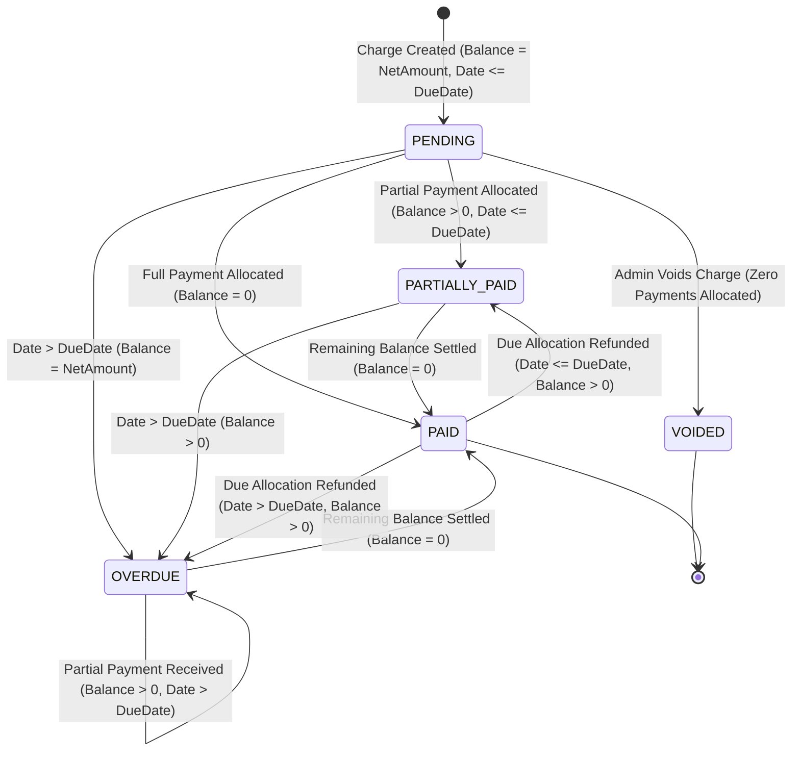
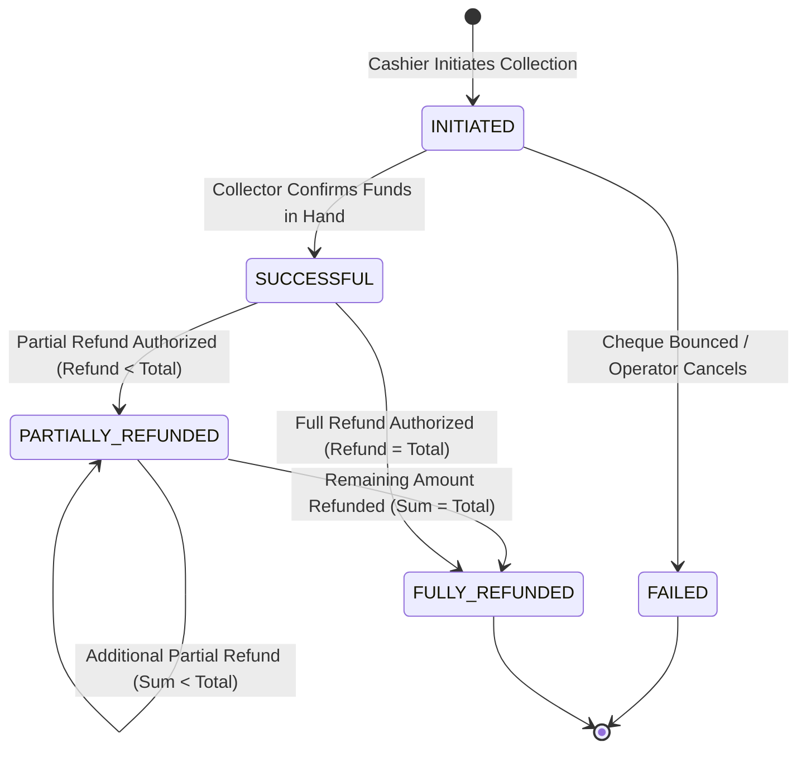
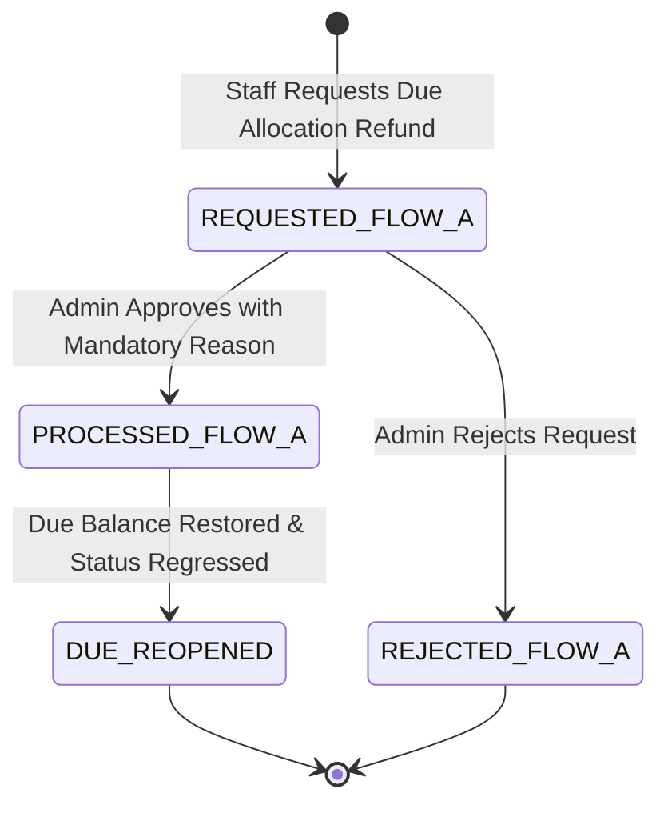
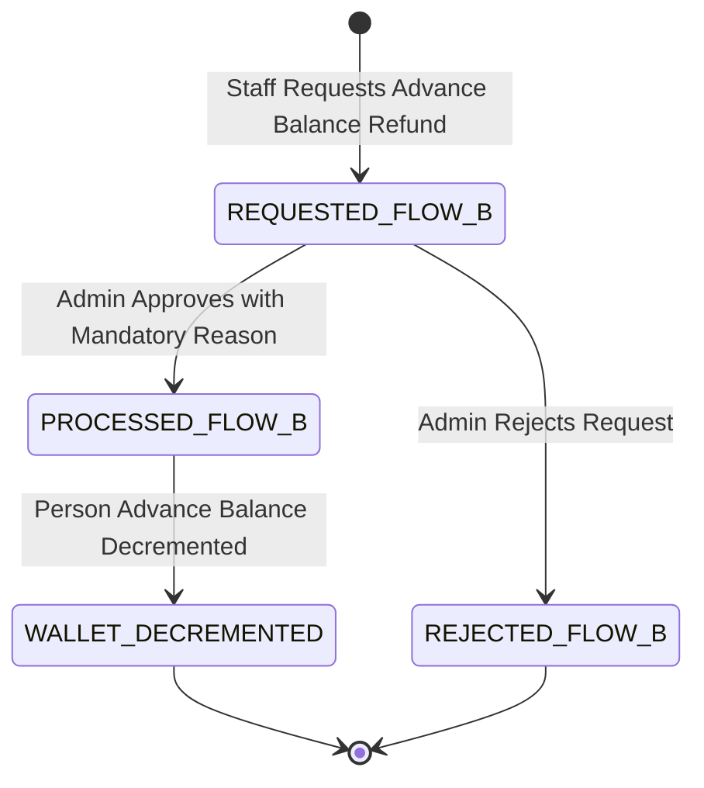

# FeeCore Universal — Financial State Models & State Transitions

**Document Version:** 2.0.0  
**Status:** Approved State Models Baseline (Post Architecture Review)  
**Source Baseline:** `docs/FeeCore_Universal_Business_Requirements_SRS_v2.docx` (Section 11, 12, 13) & Architecture Review Directives  
**Author:** Senior Software Architect & Lead QA Engineer  

---

## 1. Overview of Financial State Entities

FeeCore Universal maintains deterministic finite state machines (FSM) across six core domain entities:
1. **Due State Machine:** Governs payable lifecycle, delinquency, and settlement.
2. **Payment State Machine:** Governs monetary intake, completion, and refunding.
3. **Recurring Plan State Machine:** Governs automated schedule generation and lifecycle.
4. **Person State Machine:** Governs operational eligibility and soft deactivation.
5. **Refund State Machine:** Governs Flow A (Due Allocation Refund) and Flow B (Advance Wallet Refund).
6. **Receipt State Machine:** Governs frozen snapshots and documentary proof.

---

## 2. Due State Model

### 2.1 States Definition
* `PENDING`: Due is active, no payments allocated, and current calendar date $\le$ `due_date`.
* `PARTIALLY_PAID`: Some payment allocated ($0 < \text{BalanceRemaining} < \text{NetDueAmount}$), and current calendar date $\le$ `due_date`.
* `OVERDUE`: Payment is incomplete ($\text{BalanceRemaining} > 0$), and current calendar date $>$ `due_date`.
* `PAID`: Obligation is completely settled ($\text{BalanceRemaining} = 0$).
* `VOIDED`: Obligation was cancelled by an authorized Admin prior to any payment allocation.

### 2.2 Mermaid Diagram: Due State Machine

### 2.3 State Transition Table: Due Lifecycle

| Current State | Trigger / Event | Guard Condition | Next State | Side Effects & Ledger Actions |
| :--- | :--- | :--- | :--- | :--- |
| **None** | `CREATE_CHARGE` | `base_amount > 0` | `PENDING` | Create Due record; Record `DUE_CREATED` in Immutable Financial Transaction Ledger. |
| `PENDING` | `PAYMENT_ALLOCATED` | `allocated_amount == net_amount` | `PAID` | `balance_remaining = 0`; generate immutable Receipt with frozen snapshot. |
| `PENDING` | `PAYMENT_ALLOCATED` | `0 < allocated_amount < net_amount` | `PARTIALLY_PAID` | `balance_remaining -= allocated_amount`; Principal-first allocation applied. |
| `PENDING` | `DAILY_CRON_EVAL` | `current_date > due_date` | `OVERDUE` | Assess late fee if configured; emit internal `DueOverdueEvent`. |
| `PENDING` | `VOID_CHARGE` | `payments_count == 0` AND User has `ROLE_ADMIN` | `VOIDED` | `balance_remaining = 0`; Record `CHARGE_VOIDED` audit log entry. |
| `PARTIALLY_PAID` | `PAYMENT_ALLOCATED` | `allocated_amount == balance_remaining` | `PAID` | `balance_remaining = 0`; emit `DueSettledEvent`. |
| `PARTIALLY_PAID` | `PAYMENT_ALLOCATED` | `allocated_amount < balance_remaining` | `PARTIALLY_PAID` | `balance_remaining -= allocated_amount`; Principal-first allocation applied. |
| `PARTIALLY_PAID` | `DAILY_CRON_EVAL` | `current_date > due_date` | `OVERDUE` | Assess late fee if configured; emit internal `DueOverdueEvent`. |
| `OVERDUE` | `PAYMENT_ALLOCATED` | `allocated_amount == balance_remaining` | `PAID` | `balance_remaining = 0`; clear delinquency flags. |
| `OVERDUE` | `PAYMENT_ALLOCATED` | `allocated_amount < balance_remaining` | `OVERDUE` | `balance_remaining -= allocated_amount`; Principal-first allocation applied. |
| `PAID` | `REFUND_PROCESSED (Flow A)` | `current_date > due_date` AND `refund_amount > 0` | `OVERDUE` | `balance_remaining += refund_amount`; reopen due as overdue; record in transaction ledger. |
| `PAID` | `REFUND_PROCESSED (Flow A)` | `current_date <= due_date` AND `refund_amount > 0` | `PARTIALLY_PAID` | `balance_remaining += refund_amount`; reopen due as partially paid. |

---

## 3. Payment State Model

### 3.1 States Definition
* `INITIATED`: Payment staged in database with unique idempotency key.
* `SUCCESSFUL`: Funds confirmed received (Cash, UPI, Bank Transfer, Card, Cheque).
* `PARTIALLY_REFUNDED`: Portion of collected payment returned ($0 < \text{RefundedAmount} < \text{PaymentAmount}$).
* `FULLY_REFUNDED`: Entire collected amount returned ($\text{RefundedAmount} = \text{PaymentAmount}$).
* `FAILED`: Payment recording aborted or cancelled.

### 3.2 Mermaid Diagram: Payment State Machine

### 3.3 State Transition Table: Payment Lifecycle

| Current State | Trigger / Event | Guard Condition | Next State | Side Effects & Ledger Actions |
| :--- | :--- | :--- | :--- | :--- |
| **None** | `RECORD_PAYMENT` | Valid mode, amount > 0 | `INITIATED` | Staged payment created with `idempotency_key`. |
| `INITIATED` | `CONFIRM_COLLECTION`| Collector asserts funds collected | `SUCCESSFUL` | Update Due balances; increment tenant receipt sequence; insert Receipt snapshot; log in transaction ledger. |
| `INITIATED` | `ABORT_COLLECTION` | Operator cancels before commit | `FAILED` | Record failure reason; rollback sequence counter; zero ledger mutations. |
| `SUCCESSFUL` | `PROCESS_REFUND` | `refund_amount < payment_amount` AND `ROLE_ADMIN` | `PARTIALLY_REFUNDED` | Update allocation refunded_amount; restore target Due balance; write to transaction ledger. |
| `SUCCESSFUL` | `PROCESS_REFUND` | `refund_amount == payment_amount` AND `ROLE_ADMIN` | `FULLY_REFUNDED` | Full reversal logged; all target Dues re-opened. |
| `PARTIALLY_REFUNDED` | `PROCESS_REFUND` | `sum(refunds) == payment_amount` AND `ROLE_ADMIN` | `FULLY_REFUNDED` | Final refund slice committed; payment record fully refunded. |

---

## 4. Refund State Models — Segregated Flows

Refunds are strictly separated into two distinct state flows:

### 4.1 Flow A: Due Allocation Refund
* Reverses money collected against a specific Due.
* **Impact on Due:** Restores `due.balance_remaining` and regresses status to `OVERDUE` or `PARTIALLY_PAID`.

### 4.2 Flow B: Advance Wallet Refund
* Returns unallocated deposited credit to the Person.
* **Impact on Dues:** Zero impact on Dues. Only decrements `person.advance_balance`.

---

## 5. Receipt State Model & Frozen Snapshots

### 5.1 States Definition
* `ISSUED`: Immutable documentary proof generated inside payment transaction; frozen JSON snapshot captured.
* `AMENDED`: Refund processed against linked payment; receipt references refund memo while retaining original line items.
* `SUPERSEDED`: Entire payment refunded; receipt watermarked as superseded.

### 5.2 Receipt Lifecycle & Immutability Rules
* At creation time, the receipt captures `snapshot_data JSONB` containing payer, payment, allocation line items, org profile, and template version (`"v1.0"`).
* All future viewing, printing, or PDF generation renders deterministically from this frozen snapshot.
* Historical receipts are immune to future edits of tenant settings, pricing, or customer names.
